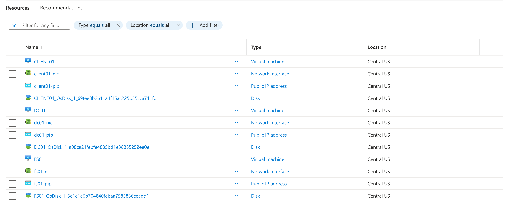

Azure NTFS File Server Lab — Terraform + Active Directory

A fully automated, Infrastructure-as-Code deployment of an Active Directory file server environment on Azure — built with Terraform and PowerShell, and used to enforce real role-based access control across four departments.

## Repository Structure

```
azure-ntfs-file-server-lab/
├── backend.tf
├── versions.tf
├── variables.tf
├── main.tf
├── keyvault.tf
├── outputs.tf
├── terraform.tfvars.example
├── configure-lab.ps1
└── scripts/
    ├── 00-promote-dc.ps1
    ├── 01-create-ad-users-groups.ps1
    ├── 02-configure-shares-and-permissions.ps1
    ├── 03-configure-rdp-gpo.ps1
    ├── 04-domain-join.ps1
    ├── 05-verify-ad.ps1
    ├── 05-verify-shares.ps1
    └── 06-add-rdp-users.ps1
```

This isn't a tutorial screenshot repo. Every fix in here came from a real failure I hit, diagnosed, and resolved on a live Azure subscription. The bugs — and how I found them — are documented below because that troubleshooting process is the actual point of the project.



What This Deploys
DC01 — Windows Server 2022, promoted to an Active Directory Domain Controller with DNS
FS01 — Windows Server 2022, hosting four SMB shares (Finance, HR, Sales, IT) with NTFS permissions enforced per security group
CLIENT01 — Windows 11 workstation used to test domain-user file access end to end
A VNet, subnet, and NSG scoped to a single allowed IP for RDP
An Azure Key Vault (RBAC-enabled) storing the VM admin credential — never hardcoded, never committed
The Access Model
Group	Finance	HR	Sales	IT
GRP_Finance	Modify	—	—	—
GRP_HR	Read	Modify	—	—
GRP_Sales	—	—	Modify	—
GRP_IT	Full Control	Full Control	Full Control	Full Control

Five test users are mapped into these groups and the whole model is verified live by logging in as each one and confirming exactly what they can and can't touch.

Stack
Terraform (HCL) — all infrastructure, fully declarative
Azure CLI — remote state setup, VM automation via az vm run-command
PowerShell — AD promotion, user/group creation, NTFS permission enforcement, verification scripts
Azure Key Vault — credential storage, RBAC-authorized
Real Bugs I Hit and Fixed

This is the part most lab repos skip. I'm including it because working through these is what actually taught me the platform.

1. VM SKU had zero quota on a new subscription Standard_B2as_v2 returned a hard 0 limit on az vm list-usage. Fixed by checking real quota first and switching to a size with headroom (Standard_D2s_v3).

2. The Windows 11 image reference no longer existed win11-23h2-pro had been deprecated by Microsoft. Diagnosed with az vm image list --all and swapped to the current SKU.

3. A NIC race condition on the domain controller's static IP Three NICs were being created in parallel. FS01 or CLIENT01 could grab 10.0.1.4 dynamically before DC01 claimed it statically, causing an IP already allocated failure. Fixed with an explicit depends_on forcing DC01's NIC to provision first.

4. A shell quoting bug silently corrupted my admin password Setting export TF_VAR_admin_password="...!" in zsh triggered history expansion on the ! character. The command failed silently on the first attempt — the real password baked into the VMs at creation ended up different from what I thought I'd set. This single character cost the most debugging time of the entire project and ultimately explained a cascade of unrelated-looking failures downstream (see #5).

5. A domain promotion that reported success but wasn't real Install-ADDSForest appeared to complete, and the VM rebooted as expected. But Get-WindowsFeature -Name AD-Domain-Services,DNS later showed InstallState: Available — meaning neither AD DS nor DNS had actually installed. Every downstream failure (DNS resolution timeouts, failed domain joins on FS01/CLIENT01, unresolvable AD group names, silently-skipped NTFS icacls grants) traced back to this one incomplete step. Root-caused by re-running the promotion manually with output captured directly, rather than trusting the orchestration script's exit status.

6. A corrupted RDP listener state after repeated registry edits After reconfiguring RDP to a non-default port and restarting the service manually, Get-NetTCPConnection showed the port as listening — but nothing could actually connect, even with the NSG wide open to 0.0.0.0/0. Isolated by testing RDP against a second VM on the same subnet (which connected instantly), proving the block was CLIENT01-specific rather than network-wide. A full VM reboot (not just a service restart) cleared the corrupted listener state.

How to Deploy It Yourself

Prerequisites: Terraform ≥1.5.0, Azure CLI, an Azure subscription, PowerShell 7 (pwsh) for running configure-lab.ps1.

bash
# 1. One-time remote state setup
az group create --name RG-TerraformState --location "Central US"
az storage account create --name <unique-name> --resource-group RG-TerraformState --sku Standard_LRS
az storage container create --name tfstate --account-name <unique-name>

# 2. Update backend.tf with your storage account name

# 3. Configure variables
cp terraform.tfvars.example terraform.tfvars
# Edit terraform.tfvars: set rdp_source to your IP (curl -4 ifconfig.me), pick a VM size with quota
export TF_VAR_admin_password="YourStrongPassword123"   # avoid special chars that trigger shell expansion

# 4. Deploy
az login
terraform init
terraform plan
terraform apply

# 5. Configure the domain, users, shares, and permissions
pwsh ./configure-lab.ps1 -KeyVaultName "<key-vault-name-from-output>"

# 6. Verify
# RDP into CLIENT01 as each test user and confirm access matches the table above

Tear down when done — terraform destroy. Compute cost while running is roughly $0.20–0.35/hr depending on VM size.

Why I Built This

I'm transitioning into cloud engineering from a Service Desk background — hands-on with Active Directory, ServiceNow, and network administration day to day. I wanted a project that went past "click through the Azure portal" and into the actual discipline of Infrastructure as Code: version-controlled, reproducible, and debuggable the way real production environments are. The bugs above weren't planned — they're exactly what showed up, and working through each one taught me far more about how Azure networking, AD replication, and Windows services actually behave than a clean first-try deployment ever would have.